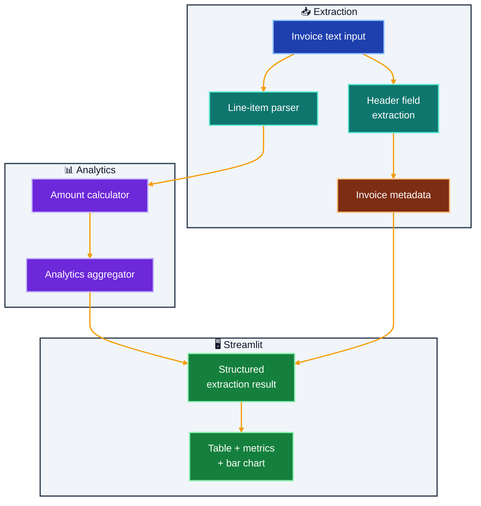

# InvoiceIQ Pipeline

Invoice extraction and analytics starter app with logging-enabled workflow.

## What It Does

- Extracts invoice header fields from raw text
- Parses line items from structured invoice-like rows
- Computes spend analytics (total, average, highest line amount)
- Visualizes extracted spending in Streamlit

## Implemented Feature Slice

- Invoice header extraction (vendor, invoice number, date)
- Line-item parsing from structured text rows (item | qty | unit_price)
- Total, average, and highest line amount analytics
- Table and bar-chart visualization in Streamlit
- Fallback total extraction when line items are not available

## Architecture



## Outcome

- Converts unstructured invoice text into structured financial data
- Provides quick spending visibility without manual spreadsheets
- Creates a foundation for OCR and multimodal extraction extensions

## Quick Start

### Prerequisites

- [UV](https://docs.astral.sh/uv/) installed (`powershell -c "irm https://astral.sh/uv/install.ps1 | iex"` on Windows)

### Run Locally

```bash
cd invoiceiq-pipeline
uv sync

uv run streamlit run app.py
```

Open [http://localhost:8501](http://localhost:8501) in your browser.

---

## Project Structure

```
invoiceiq-pipeline/
├── app.py                  # Streamlit entry point — sample text, metrics, table, bar chart
├── services/
│   ├── __init__.py
│   └── core.py             # _find_field, _parse_items, run_invoice_extraction
├── .streamlit/
│   └── config.toml         # App theme
├── pyproject.toml          # UV dependencies
└── README.md
```

---

## Logging

- Logging is configured on startup.
- Use LOG_LEVEL to adjust verbosity.
